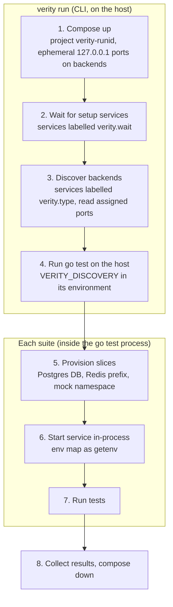

# Verity milestone 1: isolated parallel integration testing

Status: draft, 2026-10-19; progress as of 2026-10-22; switched to host-mode tests 2026-10-22

## Summary

Verity runs many integration-test suites in parallel against one shared,
ephemeral compose stack. Each suite gets its own isolated slice of every backend
(a database, a cache prefix, a mock namespace) and its own in-process instance
of the service under test, wired to that slice.

Tests run on the host with plain `go test`, against backends that the CLI
publishes on ephemeral ports bound to `127.0.0.1` only. Concurrent runs cannot
collide, because each run has its own compose project and its own ports. The
cost is one stack of compute instead of one per suite, and suites cannot see
each other's data. A CLI owns the environment and test execution; a library owns
slicing the environment up per suite. Go comes first, with a few
language-neutral seams so other languages, and a container execution mode, can
follow.

## Milestone 1 progress

As of 2026-10-22. Steps are defined under "Implementation plan: milestone 1".
The switch to host-mode tests changed the scope of steps 0, 2, 5, 6, and 7.

| Step                         | Status                                                                                                                                                                                  |
| ---------------------------- | --------------------------------------------------------------------------------------------------------------------------------------------------------------------------------------- |
| 0. Spike                     | Done. Host-mode results are in the step 0 section.                                                                                                                                      |
| 1. Clean up the CLI          | Done.                                                                                                                                                                                   |
| 2. Core types and discovery  | Done. `buildDiscovery` resolves labels; `publishLoopback` and `fillAddresses` handle ports and the host address.                                                                        |
| 3. Postgres provider         | Done. Integration tests need `VERITY_TEST_POSTGRES`; they skip without it.                                                                                                              |
| 4. Suite wiring              | Done.                                                                                                                                                                                   |
| 5. In-process service runner | Done. `Env.Addr()` returns `host.docker.internal:<port>`. The Docker side of that (reachable from a container, `host-gateway` on Linux) is checked by the step 0 host-mode spike.       |
| 6. CLI execution             | Done. End-to-end test in `cmd/verity/e2e_test.go` (opt-in: `VERITY_TEST_DOCKER=1`) covers pass, fail, `-run`, SIGINT and leftovers.                                                     |
| 7. End-to-end example        | Done. `examples/todo`; `TestEndToEnd` runs it and checks one `db` container and no leftovers.                                                                                           |

## Problem

Running integration tests in parallel forces a choice between compute cost and
isolation, and today's options each give up one.

| Approach                                                        | Compute                                    | Isolation                                                                          |
| --------------------------------------------------------------- | ------------------------------------------ | ---------------------------------------------------------------------------------- |
| A full stack per parallel run (databases, caches, mock servers) | Multiplies with parallelism; too expensive | Strong                                                                             |
| One shared stack for all runs                                   | Low, one stack                             | Suites collide on data and state; parallel testing is very difficult or impossible |

The gap is a way to share the expensive infrastructure while still isolating
what each suite touches.

## Goals and non-goals

**Goals**

- Many suites run in parallel against a single shared stack with no cross-suite
  interference.
- Each suite gets isolated resources and its own service instance, configured
  with those resources.
- Provisioning lives in a library, with no coordination server.
- Compose is the single source of truth for what backends exist; there is no
  second config to keep in sync.
- Tests run as ordinary `go test`, so IDE debugging works and any `go test`
  flag works, through `verity run -- <args>`.
- The design leaves seams for other languages and environments without building
  them now.

**Non-goals (first version)**

- Long-lived or shared environments. The stack is always created and destroyed
  by the CLI, so there are no leases, TTLs, or orphan sweeping.
- A container execution mode (tests running in containers on the compose
  network, with no published ports). It is deferred, not rejected; see
  "Alternatives considered".
- Remote Docker daemons. Published ports are on the daemon's host, not on
  `127.0.0.1`.
- Non-Go test languages, remote provisioning servers, and Kubernetes support.
- A public provider API. Third-party providers are a likely later goal, but for
  now every provider lives in this repo and the provider types stay in
  `internal/core`. When third-party support is added, the types are re-exported
  from the root package as aliases; retracting a public type would be a breaking
  change, so we don't expose them early.
- Testing a service's `main()` wiring. The service runs in-process through an
  exported entrypoint.

## Design overview



1. **Environment up.** The CLI starts the shared stack with a per-run project
   name. It adds an ephemeral published port, bound to `127.0.0.1`, to every
   labelled backend.
2. **Setup.** The CLI waits for every service labelled `verity.wait` (schema,
   migrations) to exit 0.
3. **Discovery.** The CLI finds every service labelled `verity.type`, reads the
   host port that Docker assigned, and resolves it to an address such as
   `127.0.0.1:49153`.
4. **Run.** The CLI runs `go test` on the host with the discovery info in its
   environment. `go test -p` provides package-level parallelism.
5. **Suite provisions.** When a suite is created, its providers allocate an
   isolated slice of each backend and return an env map plus typed connection
   info.
6. **Service starts.** The suite starts its own instance of the service
   in-process, configured from that env map, so the dynamic database name, cache
   prefix, and so on are present from the first line of startup.
7. **Tests run** against the suite's service.
8. **Teardown.** The CLI passes through the test exit code and destroys the
   stack with `Down`. Per-suite cleanup is optional.

## Components

- **CLI (`verity run`).** Loads config from flags, yaml, and env (test-running
  options only; backends come from compose). Brings up the environment with
  published ports, waits for setup services, discovers backends, runs `go test`
  on the host with the discovery info in its environment, passes through its
  output and exit code, and always tears the stack down.
- **Providers.** One per backend type. A provider is a registered value that
  caches one small admin connection pool per endpoint, shared per process.
  `Provision` takes a run ID and suite ID and returns a slice of the backend: an
  env map plus typed connection info. Providers do not set up schema or data:
  the compose stack does that before tests start (a schema service, then
  migrations), and a provider clones the result. The CLI keeps only a small
  per-type table of discovery defaults (internal port, which env vars hold the
  admin credentials).
- **Runner.** Starts the service under test in-process from a user-supplied
  function. Verity builds the merged env map, creates the listener, waits for
  readiness, and cancels the context on cleanup.
- **Go binding.** `Suite`, `Option`, and the generic table-test type. The core
  exposes one generic option, `verity.Use`, and never imports a specific
  backend. Backend packages (such as `verity/providers/postgres`) register their
  providers with the internal registry when imported. Resources are read back by
  name and type.

```go
suite := verity.NewSuite[MySuite](t,
    verity.Use("db"),    // compose service name; type comes from its verity.type label
    verity.Use("cache"),
    verity.WithService(func(ctx context.Context, env verity.Env) error {
        return myservice.Run(ctx, env.Getenv, env.Listener())
    }),
)

pg := verity.Get[*postgres.Database](suite, "db")
```

The provider types (`Provider`, `Request`, `Resource`) live in `internal/core`,
have no `testing.T`, and are not public API in milestone 1; see "Internal types"
under Pinned interfaces.

A backend package registers its type from `init` (for example
`core.RegisterProvider("postgres", provider{})` in `verity/providers/postgres`),
so importing the package makes the type available. Third-party providers are
deferred; see the non-goals. Provisioning of independent resources runs
concurrently. The env variable names a provider emits are configurable per use,
because services name them differently.

## Contracts

Only data that crosses a process boundary is formalized; everything inside the
Go process stays idiomatic Go and can change freely.

| Contract       | Between          | Shape                                                                                                                                                                                                                                            |
| -------------- | ---------------- | ------------------------------------------------------------------------------------------------------------------------------------------------------------------------------------------------------------------------------------------------ |
| Compose labels | User to CLI      | `verity.type` marks a backend and selects its provider. Optional labels override per-type defaults, such as the internal port. The service name is the handle suites use.                                                                        |
| Discovery      | CLI to tests     | Env vars (or one JSON blob) with a protocol version: run ID plus `name -> {type, host, port, credentials}` per backend, using the host address and the published port (`127.0.0.1:<assigned>`). Set in the environment of the `go test` process. |
| Provider       | Suite to backend | `Provision(runID, suiteID)` returns an env map plus typed metadata. Plain serializable structs, no `testing.T`.                                                                                                                                  |
| Runner         | Suite to service | The env map. The in-process runner passes it as `getenv`; a future binary or container runner passes it as environment variables.                                                                                                                |

### Requirements on the service under test (in-process runner)

- An injectable entrypoint such as `Run(ctx, getenv, listener)`, not logic
  buried in `main()`.
- Config read through the supplied `getenv`, never `os.Getenv` or `os.Setenv`,
  so parallel suites do not interfere.
- A listener supplied by verity, bound to all interfaces, and a readiness
  signal: a health endpoint or a channel.
- Shutdown driven by context cancellation.
- No process-global state. Default Prometheus registries, `flag` parsing,
  package-level singletons, `init()`-time config reads, and global loggers all
  break when two instances share a process.

When a backend must call back into the service (a webhook from the mock server,
say), the backend runs in a container and the service runs on the host, so
`127.0.0.1` does not work from the backend. `Env.Addr()` returns
`host.docker.internal:<port>`, which works on Docker Desktop. On Linux, the
CLI adds `extra_hosts: ["host.docker.internal:host-gateway"]` to every compose
service, preserving any existing mapping for that hostname (milestone 2).

## Isolation model

Names are unique per run and suite (derived from the suite's `UniqueName` plus a
random suffix), so provisioning needs no coordination between suites or between
test binaries running as separate processes. Isolation strength varies by
backend, and each provider should declare its level so a suite can state what it
needs.

| Backend                      | Slice                                                                                                                             | Isolation                       |
| ---------------------------- | --------------------------------------------------------------------------------------------------------------------------------- | ------------------------------- |
| Postgres                     | `CREATE DATABASE ... TEMPLATE` from the database the compose stack already populated with its schema; no migrations run in verity | Database-level, cheap to clone  |
| Redis                        | Key prefix, ACL user restricted to the prefix, or a numbered DB (only 16). A prefix only works if the service applies it          | Weak (prefix) to moderate (ACL) |
| Mock server                  | Per-suite base URL or namespace. Header-based routing is avoided because it depends on the service propagating headers            | Moderate                        |
| Object store, message broker | Bucket or topic prefix                                                                                                            | Prefix-level                    |

Postgres suites use a unique non-superuser role that owns their clone. On the
dedicated backend, the provider revokes `PUBLIC CONNECT` from existing databases
and grants access to cloned schema objects; suite credentials cannot connect to
other suites or the source. Server-wide operations are denied. Existing cloned
objects retain their source owners. This protects cooperating tests, not
untrusted SQL or privileged security-definer routines. See the README for the
connection-grant compatibility change and `postgres.ConnLimit` budgeting.

Because cloning is cheap for some backends, per-test isolation is possible
later, not only per-suite.

## Lifecycle and failure handling

The stack is always ephemeral, so teardown is the cleanup mechanism.

- **No leases, heartbeats, or sweeping.** `compose down` reclaims everything,
  because every container in the run is compose-owned. Per-suite `Release` is
  optional and only worth doing to free connections or database slots mid-run.
- **Setup is compose-owned.** Schema and migrations are compose services that
  finish before any suite starts (see the setup wait in step 6). Providers only
  clone what is there, so they hold no locks and the CLI stays
  backend-agnostic. Step 3 showed Postgres 17 handles concurrent clones of one
  source without a lock. Postgres refuses to clone a database that has sessions,
  so no other compose service (an app, pgbouncer, a tool) may stay connected to
  the schema database. Suites connect only to their own clones, which does not
  block other clones.
- **The CLI is required.** It is the only thing that creates the environment and
  publishes the ports. If discovery info is missing, tests fail with a clear
  message.
- **Teardown must be reliable.** The CLI handles signals (Ctrl-C) and failures
  so `Down` always runs, on a fresh context rather than the cancelled one.
  SIGKILL, or a crash of the CLI, cannot be handled: the stack stays up. Its
  containers carry the compose project label `verity-<runid>`, which makes them
  findable with `docker ps --filter`. A reaper sidecar would close this gap
  later (see "Deliberately deferred").
- **`--keep` flag.** Skips teardown and prints the project name and the
  `VERITY_DISCOVERY` value, so a failed run can be inspected or one test can be
  run from an IDE against the live stack.
- **Failure context.** On test failure, attach compose service logs for the
  test's time window via `t.Log`. This is probably the most useful single
  debugging feature.
- **Concurrency.** `go test -p` bounds the number of packages running at once;
  `-parallel` bounds tests within a package.
- **Connection limits.** Every suite starts its own service instance with its
  own database pool, so connections grow with packages, suites, and pool size
  (8 packages of 3 suites with a pool of 10 is 240). Postgres allows 100 by
  default and refuses the rest. In milestone 1 this is the user's to size: set
  `max_connections` on the Postgres service in compose, and keep service pools
  small in tests. Verity caps only its own admin pool.

## Extensibility

Start with Go, but keep these seams so other languages and environments can be
added without redesign.

1. **Environment** (CLI): compose now; k8s or others later behind `Up`, `Down`,
   and `Discover`. Discovery is plain data, so another environment only needs to
   produce the same `name -> {type, host, port, credentials}` map.
2. **Discovery contract:** documented, language-neutral, versioned.
3. **Provider contract:** serializable request and response. If providers are
   Go-only, every new language must reimplement every backend. A later `verity
   serve` process could expose the same operations over HTTP, with
   other-language SDKs as thin clients. Until then the Go library calls the
   provider implementations directly.
4. **Runner:** a binary or container runner can reuse the same env map.
5. **Test adapter** (CLI to test command): an adapter answers what command runs
   the tests. For Go that is `go test` on the host. A Python adapter would be
   `pytest`.
6. **Execution mode:** where the test command runs. Host mode is the only mode in
   milestone 1. A container mode would change two things only: how discovery
   addresses are produced (service names and internal ports, with no published
   ports), and how the tests run (a built binary in a container on the compose
   network). Keep address resolution and test execution as separate functions in
   the CLI so a second mode can slot in. Do not add an abstract interface until
   there is a second implementation.

**Package hygiene.** Keep `testing.T` out of the core:

- `internal/core`, with no `testing` import: provider and resource types, the
  provider registry, the discovery format.
- A Go-testing package: suites, options, table tests, as a thin binding over the
  core.
- Per-backend provider packages (such as `verity/providers/postgres`) so users
  only pull in the drivers they use.

**Deliberately deferred:**

- **Container mode.** Tests run as built binaries in minimal containers on the
  compose network, with no published ports. It would bring back no-collision by
  construction, backend-to-service callbacks by container alias, and CI that
  behaves like local. It costs a lot: per-package cross-compiled binaries, a
  `CGO_ENABLED=0` static build (which rules out cgo dependencies and `-race`), a
  read-only source mount (no golden-file updates, coverage needs a writable
  mount), a daemon that can see host paths (Docker-in-Docker and remote daemons
  need a copy-in fallback), test containers to label and remove, and the loss of
  the IDE debugger, the test cache, and most `go test` flags. On Docker Desktop
  the tests would also share the VM's fixed CPU allocation instead of the host's
  cores. Earlier PoC work suggests host mode is the better default; container
  mode would be an option, not a replacement.
- The remote provisioning protocol, non-Go adapters, and Kubernetes.
- **Reaper sidecar.** A small container that holds a connection open to the CLI.
  When the connection drops, as it does when the CLI is killed, the reaper
  removes everything in the compose project `verity-<runid>`, so even SIGKILL
  leaves nothing behind. It costs one extra image and a Docker socket mount into
  it.

Avoid anything that would make these hard to add: Go-specific types in
contracts, `testing.T` in provider code, or provider behavior that depends on
in-process state.

## Required changes to the current codebase

- Rework `verity run` to bring up the stack with ephemeral published ports on
  `127.0.0.1`, then run `go test` on the host with `VERITY_DISCOVERY` in its
  environment. The CLI keeps the host `go test`; `go.parallel_packages` becomes
  `-p`, and `-parallel`, `-failfast`, `-run`, `-timeout`, and `-v` are passed to
  it.
- Replace the `VERITY_URL`, hostname, and port plumbing with discovery info
  resolved from compose labels and the assigned host ports, and set in the
  environment of the `go test` process.
- Make the compose project name per-run (`verity-<runid>`) instead of the
  hardcoded `verity`.
- Add signal handling and a `--keep` flag to the CLI.
- Fix the `After` hook in `run_command.go`: it type-asserts a nil service and
  panics when compose is disabled.
- Fix the `dir` vs `go-dir` mismatch: `setConfiguration` reads `dir`, but the
  flag is `go-dir`.
- Remove the discarded Docker client created in `sourceChain`.
- Apply options after setting `ID` and `UniqueName` in `NewSuite`; providers
  need them.
- Register teardown with `t.Cleanup` instead of `BeforeFunc`/`AfterFunc` and
  `AfterSuite`. `t.Fatal` calls `runtime.Goexit`, which skips the current hooks
  on failure.
- Split the root package into `internal/core`, the Go binding, and per-backend
  provider packages, and add the provider registry and `verity.Use` /
  `verity.Get`.
- Change `Env.Addr()` in `service.go` from `os.Hostname()` plus the port to
  `host.docker.internal` plus the port.

## Alternatives considered

- **A full stack per suite or run.** Strongest isolation, but compute multiplies
  with parallelism. This is the problem being solved.
- **A provisioning server (broker) from the start.** Gives cross-process
  coordination, leases, queueing, and keeps admin credentials out of tests.
  Unnecessary when the environment is always ephemeral and unique names avoid
  collisions. The provider contract is shaped so a server can be added later
  behind the same interface.
- **Declaring backends in a separate `verity.yaml`.** Duplicates what compose
  already says. Labels on compose services keep one source of truth.
- **Inferring backend type from the image name.** Needs no labels but can guess
  wrong (a custom image built on `postgres`). Explicit `verity.type` labels are
  easier to debug.
- **Fixed published ports from the user's compose file.** Concurrent runs on one
  daemon would collide. The CLI publishes ephemeral ports itself.
- **Tests in containers on the compose network.** A compiled binary in a minimal
  image, `go test` inside a `golang` container, or a user-defined runner service
  in compose. It gives no published ports and working backend callbacks, but it
  loses the debugger, `-race`, coverage, the test cache, and flags, rules out
  cgo, and on Docker Desktop caps the tests at the VM's CPU allocation. Deferred
  as an optional container mode; see "Deliberately deferred".
- **Binary or container runner for the service under test.** Dynamic
  configuration can be injected at launch, so in-process is not strictly
  required. In-process is chosen for speed and Go-typed config. The env map
  keeps the door open to other runners.
- **Standalone `go test` mode with self-managed infrastructure.** Dropped; the
  CLI is the only environment creator.

## Decisions for milestone 1

These resolve the earlier open questions with working defaults. Change them here
before implementation starts if any is wrong. Rows marked "default" were not
explicitly confirmed.

| Question                                          | Decision                                                                                                                                                                                                                                                                                                        |
| ------------------------------------------------- | --------------------------------------------------------------------------------------------------------------------------------------------------------------------------------------------------------------------------------------------------------------------------------------------------------------- |
| Which backends first?                             | Postgres only. Redis and a mock server are milestone 2.                                                                                                                                                                                                                                                         |
| Target services take injected config?             | Assumed yes: the example service exposes `Run(ctx, getenv, listener)`. Services that read globals are out of scope.                                                                                                                                                                                             |
| Per-suite or per-test isolation?                  | Per-suite. Per-test is later.                                                                                                                                                                                                                                                                                   |
| How do providers learn project-specific setup?    | They do not. Schema and migrations are compose services that run during `Up`; the provider clones the database named by `verity.database` (or `POSTGRES_DB`). Provider options include `postgres.EnvName` and `postgres.ConnLimit`.                                                                                                   |
| Admin credentials                                 | The `verity.user`, `verity.password` and `verity.database` labels win; otherwise read the service's standard env vars from the loaded compose project (`POSTGRES_USER`, `POSTGRES_PASSWORD`, `POSTGRES_DB`). The `*_FILE` variants are not read: discovery fails with an error naming the label to use instead. |
| Where do tests run?                               | On the host, with plain `go test`. Container mode is deferred and would be an option later.                                                                                                                                                                                                                     |
| How do backends get reachable ports? (default)    | The CLI adds an ephemeral published port to every labelled backend before `Up`, bound to `127.0.0.1` only, and replaces any `ports` the user set on it. It reads the assigned port after `Up`. Binding to `127.0.0.1` matters: the default would expose Postgres and its admin credentials to the network.      |
| Race detector                                     | No plan to add a named config key: integration tests rarely hit races. `verity run -- -race` works through the pass-through.                                                                                                                                                                                    |
| Coverage                                          | A named config key is a later addition. `verity run -- -cover -coverpkg=./...` works through the pass-through and covers the in-process service.                                                                                                                                                                |
| Callbacks from a backend to the service (default) | Best-effort: `Env.Addr()` returns `host.docker.internal:<port>`. Linux needs `extra_hosts` with `host-gateway` on the calling service.                                                                                                                                                                          |
| Remote Docker daemons (default)                   | Not supported in milestone 1. Published ports are on the daemon's host, not `127.0.0.1`.                                                                                                                                                                                                                        |
| Service readiness                                 | HTTP 200 from a health path (default `/healthz`, 30s timeout), configurable per `WithService`.                                                                                                                                                                                                                  |

## Pinned interfaces (milestone 1)

These supersede the looser sketches above where they differ.

### Compose labels

| Label                                               | Required | Meaning                                                                                                                                                                                                     |
| --------------------------------------------------- | -------- | ----------------------------------------------------------------------------------------------------------------------------------------------------------------------------------------------------------- |
| `verity.type`                                       | yes      | Backend type, such as `postgres`. Selects the provider.                                                                                                                                                     |
| `verity.port`                                       | no       | Internal port that the CLI publishes; default per type (5432 for Postgres). Discovery's `port` is the assigned host port, not this one.                                                                     |
| `verity.user`, `verity.password`, `verity.database` | no       | Admin credential overrides. For Postgres, `verity.database` (or `POSTGRES_DB`) names the database holding the schema that suites clone. It must not be `postgres`, which verity uses as its admin database. |
| `verity.wait`                                       | no       | Marks a setup service (schema, migrations) that runs once. The CLI waits for it to exit 0 before any suite starts, and fails the run if it exits non-zero or outlasts `docker_compose.wait_timeout`.        |

The compose service name is the backend's handle. Backends must not publish
fixed host ports: they would collide between concurrent runs. The CLI publishes
the ports.

### Discovery

The CLI sets one env var, `VERITY_DISCOVERY`, in the environment of the `go test`
process, holding JSON:

```json
{
  "version": 1,
  "run_id": "k3f9a2",
  "backends": {
    "db": {
      "type": "postgres",
      "host": "127.0.0.1",
      "port": 49153,
      "user": "postgres",
      "password": "postgres",
      "database": "todo"
    }
  }
}
```

`host` and `port` are where the host reaches the backend: `127.0.0.1` and the
port that Docker assigned. For Postgres, `database` is the schema database that
suites clone, not the admin database verity connects to (that is always
`postgres`).

If the variable is missing or `version` is unsupported, `verity.NewSuite` fails
the test with a message that says to run through `verity run`. This applies only
to suites that call `verity.Use`; a suite with no `Use` never reads the
variable, so it also runs under a plain `go test`.

### Internal types (`internal/core`, not public API)

```go
// Package core (internal/core). No testing import.
type Endpoint struct {
    Name, Type, Host string
    Port             int
    User, Password, Database string
}
type Request struct {
    RunID, SuiteID string
    Endpoint       Endpoint
    Options        []any
}
type Resource struct {
    Env     map[string]string
    Handle  any
    Release func(context.Context) error // optional
}
type Provider interface {
    Provision(ctx context.Context, req Request) (*Resource, error)
}
func RegisterProvider(typ string, p Provider)

const DiscoveryEnv = "VERITY_DISCOVERY"
const DiscoveryVersion = 1
type Discovery struct {
    Version  int
    RunID    string
    Backends map[string]Endpoint // Endpoint.Name is the map key; not in the JSON
}
func (Discovery) Encode() (string, error)
func DecodeDiscovery(s string) (*Discovery, error)
func LookupProvider(typ string) (Provider, bool)
```

`RegisterProvider` panics on a nil or duplicate registration, like
`database/sql.Register`. The CLI and the library are the only users, so the
discovery JSON, not these Go types, is the cross-language contract.

### Go API (package `verity`, plus `verity/providers/postgres`)

```go
// Suite options.
func Use(name string, opts ...any) Option
func WithService(fn ServiceFunc, opts ...ServiceOption) Option
func ReadyPath(path string) ServiceOption
func WithEnv(env map[string]string) Option // static config for the service, such as a JWT secret
func Get[T any](s TestSuite, name string) T // fails the test if missing or wrong type

type ServiceFunc func(ctx context.Context, env Env) error // blocks until ctx is cancelled
type Env struct{ /* unexported */ }
func (Env) Getenv(key string) string // merged env from all resources and WithEnv
func (Env) Listener() net.Listener   // pre-bound, all interfaces, port 0
func (Env) Addr() string             // host.docker.internal:port, for callbacks from backends

// Postgres provider.
type Database struct{ /* unexported */ }
func (*Database) DSN() string
func (*Database) DB() *sql.DB // pgx stdlib driver
func (*Database) Name() string
func EnvName(name string) any // default env var: DATABASE_URL
func ConnLimit(n int) any // positive per-suite connection cap; default unlimited
// The provider type is unexported; the package registers it from init.
```

`NewSuite` runs in this order: set `ID` and `UniqueName`, provision all `Use`
resources concurrently, merge their env maps with any `WithEnv` values, then
start the service from `WithService` and wait for readiness. This holds
regardless of the order options are passed in. Cleanup is registered with
`t.Cleanup`, in reverse order (service first, then resources). `Init` runs after
the ID is set and before provisioning. Names and providers are validated before
anything is provisioned (unknown backend name, a name used twice, no provider
for the type). Two resources (or a resource and `WithEnv`) emitting the same env
var can only be found once `Provision` has returned their env, so that check
runs right after provisioning and the resources are released. The service never
reads the process environment: `Getenv` returns only these merged values. A
partial provisioning failure, or a provider panic, still releases what was
created. `AfterSuite` and `Tests` `AfterFunc` also run through `t.Cleanup`, so
they run when a test fails fatally. That changes timing: `AfterSuite` now runs
when the enclosing test ends, not when `RunSuite` returns, which also fixes it
running before `t.Parallel` test methods, and always before the resources are
released; `AfterFunc` runs after any cleanups the test function registered.
Provisioning has no timeout of its own beyond `go test -timeout`.

`Option` changes from `func(*testing.T, TestSuite) error` to an interface that
`NewSuite` collects and applies in these phases. This is a breaking change to
the existing type, which is acceptable because the old options were removed.
`Get` reads resources from an unexported map on the embedded `Suite`, so
`TestSuite` gains an unexported accessor.

### CLI

```
verity run [--docker-compose-file ./docker-compose.yaml] [--keep] [--debug] [-- <go test args>]
```

Config keys (flags, yaml, env as today): `go.dir`, `go.parallel_packages`,
`go.parallel_tests`, `go.tags`, `go.verbose`, `go.fail_fast`, `go.run`,
`go.timeout`, `docker_compose.file`, `docker_compose.wait_timeout`.
`docker_compose.enabled` is removed; compose is required. `go.image` is not
needed in host mode.

Packages go before `--`, as in `go test`; everything after `--` goes to `go test`
unchanged. So `verity run ./examples/... -- -race -run TestTodo` and `verity run
./pkg/a ./pkg/b` both work. `go.dir` (default `./...`) is the default package set,
used when no package is given before `--`. The CLI splits its own arguments at
the first `--` before parsing, because the CLI library drops the `--` and with it
the boundary, so it never has to guess whether an arg is a package or a flag
value. A `go test` flag typed before `--` is rejected as an unknown flag. The CLI puts the flags it builds from
config first (`-p`, `-parallel`, `-v`, `-failfast`, `-tags`, `-run`,
`-timeout`) and the user's args after them. For a repeated flag such as `-run`
or `-timeout`, `go test` uses the last one, so the command line overrides the
config default. `go.run` and `go.timeout` remain as config defaults, for example
in `verity.yaml` for CI. The CLI does not validate the args. `-c`, `-o`, and
`-exec` break the run and are unsupported.

The CLI always passes `-count=1`, so the `go test` cache is off. Integration
tests depend on a live stack, and a cached pass would skip the backends
entirely. A later `-count=N` in the args after `--` overrides it, as for any
repeated flag.

## Implementation plan: milestone 1 (walking skeleton)

**Definition of done.** From the example directory, `verity run` brings up a
compose stack with one labelled Postgres whose host port is ephemeral and bound
to `127.0.0.1` only, runs at least two test packages in parallel, each starting
its own in-process service on its own database, passes, and leaves no containers
or networks behind (`docker ps -a` and `docker network ls` show nothing from the
run). Killing the CLI with Ctrl-C mid-run leaves the same clean state.

**Environment.** The sandbox has a Docker daemon and the compose plugin.
`go.mod` requires Go 1.27, so confirm the sandbox toolchain matches or can
download it. `pgx/v5` and `go-redis` are already dependencies.

**Fixtures for verity's own tests.** Tests that need a real Postgres (step 3)
read its DSN from `VERITY_TEST_POSTGRES` and skip when it is unset. A
`test-integration` mise task (this repo uses `mise.toml`, not a Makefile) brings
up a throwaway Postgres with compose on a fixed published port, runs `go test
./...`, and tears it down. This fixture is for verity's own tests and does not go
through `verity run`, so it does not use the CLI's ephemeral ports.

**Out of scope for milestone 1.** Redis, mock server, per-test isolation,
failure-log capture, `verity discover`, named config keys for coverage and `-race`,
container mode (including copy-in for daemons that cannot see host paths),
non-Go languages, remote daemons.

### Step 0: Spike to verify assumptions

Throwaway code, results written into this section.

- **Host mode (new, not done).** Using the `docker/compose/v5` library the CLI
  already imports: load a compose file, add an ephemeral published port bound to
  `127.0.0.1` to a labelled service before `Up`, `Up` with `Wait`, and read the
  assigned host port back afterwards. Confirm the host reaches the service at
  `127.0.0.1:<assigned>`. Confirm that a compose service can reach a listener on
  the host through `host.docker.internal` (with `host-gateway` on Linux), for
  `Env.Addr()`. Step 6 depends on this.
- **Container mode (deferred; results below still hold).** Using the same
  library: load a compose file, `Up` with `Wait`, and read labels from the loaded
  project. Confirm a container on the project network reaches the service by its
  compose service name and internal port, with no published ports.
- **Container mode.** Run a container attached to the project network from the
  Docker API, with a bind mount and an explicit network alias, and read its exit
  code and output. Confirm another container can reach it by that alias, and that
  the daemon can see the host paths being mounted.
- **Container mode.** Cross-compile a `go test -c` binary for linux (one package
  at a time: `go test -c` rejects multiple packages, and writes no binary for
  packages without tests), run it in `distroless/static`, and confirm a
  package's `testdata` and a file in a sibling directory are readable through the
  module-root mount.
- **Container mode.** Output aggregation. The binary's `-test.v=test2json` output
  still needs `go tool test2json` to become JSON. Decide whether to stream raw
  `-test.v` output and aggregate by exit code (the working default), or pipe
  through `go tool test2json` on the host. In host mode this does not arise:
  `go test` prints its own output.

Acceptance: each bullet is confirmed or replaced with a working alternative, and
the decisions table above is updated if any default changes.

**Results (2026-10-20, Docker 29.8.1 arm64, compose plugin v5.5.1,
`docker/compose/v5` v5.1.3).** These were gathered for container mode. The first
bullet and the one-shot services bullet also apply to host mode.

- **Compose library: confirmed.** `LoadProject` exposes labels
  (`project.Services["db"].Labels`) and ports (empty for an unpublished
  service). `Environment` values are `*string`, which matters for step 2's
  credential defaults. `Up` with `Wait` returned in about 1.6s for Postgres with
  a healthcheck. A container on `<project>_default` reaches `db:5432` by service
  name.
- **Containers from the Docker API: confirmed (container mode).** A container
  created with a bind mount and an alias on `<project>_default` runs, and its
  exit code and logs come back (`ContainerWait` plus `stdcopy.StdCopy`). A second
  container reaches it by its alias. The daemon sees host paths here; the
  copy-in fallback was not needed. macOS bind-mount behaviour is still
  unmeasured (open question 2).
- **Test binaries: confirmed (container mode).** `go test -c -o` per package
  with `CGO_ENABLED=0 GOOS=linux GOARCH=<arch>` runs in
  `distroless/static-debian12`. A package without tests prints `[no test files]`
  and writes no binary. With the module root mounted read-only at its host path
  and the package directory as the working directory, `testdata/x.txt` and
  `../../shared/y.txt` were both readable. Pass and fail runs gave exit 0 and 1
  with readable `-test.v` output. Take the architecture from
  `ServerVersion().Arch` (`arm64`), not `Info().Architecture` (`aarch64`, not a
  valid `GOARCH`). The test binary must itself be visible in the container, so
  write binaries to a directory under the module root (or mount a second
  directory).
- **Output aggregation: decided (container mode).** Stream raw `-test.v` output
  and aggregate by exit code. `go tool test2json` is deferred.
- **Teardown (container mode).** `Down` with `RemoveOrphans` does not remove
  containers that only carry the `com.docker.compose.project` label. Exited ones
  were left behind. A container still running at `Down` time was also left
  behind, and the network was left behind with it, with `Down` returning no
  error. This matters only for containers the CLI starts itself. In host mode
  every container is compose-owned and `Down` is enough; in container mode the
  CLI would have to force-remove its test containers (by a `verity.run=<runid>`
  label) before calling `Down`, including on SIGINT.
- **One-shot services: `Up` with `Wait` does not wait for them (step 3 spike).**
  With a `schema` service that `depends_on` the healthy Postgres, sleeps 4s,
  creates a table and exits 0, `Up` returned after about 2s with the schema
  service still running and the table not yet created. Suites would clone an
  empty database. Step 6 must wait for one-shot services itself.
- **Host mode: confirmed (2026-10-23, Docker 29.9.2 linux, same library
  version).** Appending `types.ServicePortConfig{HostIP: "127.0.0.1", Target: 80,
  Protocol: "tcp"}` (empty `Published`) to a loaded service before `Up` publishes
  one ephemeral port. After `Up`, `Ps(ctx, project, PsOptions{All: true})` returns
  per-container `Publishers` with `TargetPort` and `PublishedPort`
  (`Port(ctx, project, service, target, PortOptions{Protocol: "tcp"})` returns
  `"127.0.0.1"` and the port too). The host reached it at `127.0.0.1:<port>`, and
  the same port refused connections on the host's non-loopback address.
  Unpublished ports have `PublishedPort` 0, so skip those.
- **`host.docker.internal`: confirmed.** A container with
  `extra_hosts: ["host.docker.internal:host-gateway"]` (compose, or
  `docker run --add-host`) reached a host listener bound to `0.0.0.0`. Without
  `host-gateway` the name does not resolve on Linux (Docker Engine; Docker
  Desktop on macOS defines it itself and was not tested), so a service under test
  that runs in compose needs that `extra_hosts` entry. A host listener bound only
  to `127.0.0.1` was refused from the container on Linux, so `Env.Listener()`
  binding `:0` (all interfaces) is required, not incidental.
- **`Up` with `Wait` fails if a one-shot service exits fast.** A `verity.wait`
  service that exits 0 before `Up` finishes makes `Up` return
  `container <name> exited (0)`, even though it succeeded. A slow one (4s sleep)
  was left running and `Up` returned normally, as above. Compose's `Wait`
  accepts a service that is healthy or running, except one that another service
  `depends_on` with `service_completed_successfully`, and any exited container
  fails it (compose `convergence.go`, `isServiceHealthy`). There is no
  per-service switch, so step 6 catches the `Up` error: `Ps` with `All`, and if
  every container that is not running is a `verity.wait` service with exit 0,
  carry on to the CLI's own wait; otherwise fail.

### Step 1: Clean up the existing CLI

- Fix the `dir` vs `go-dir` mismatch in `setConfiguration`.
- Fix the `After` hook panic in `run_command.go` (nil type assertion when
  compose is disabled). Compose becomes required, so remove the `enabled` flag.
- Remove the discarded Docker client in `sourceChain`.
- Fix `go-fail-fast`: its usage says "True by default" but the flag has no
  default value, so it is false.
- Remove the `hostname` and `port` reads in `setConfiguration`; no such flags
  exist, so they always return empty values.

Acceptance: `go build ./...` and `go vet ./...` pass; a unit test covers
`setConfiguration` reading the right flag and the fail-fast default.

### Step 2: Core types and discovery

- Add `Endpoint`, `Request`, `Resource`, `Provider`, `RegisterProvider`, and the
  discovery JSON encode and decode, in `internal/core` (no `testing` import; the
  root package imports `testing`, so it cannot hold them).
- CLI side: build the discovery document from a loaded compose project's
  `verity.*` labels and per-type defaults. The code today fills `Host` with the
  service name and `Port` with the internal port. Host mode replaces them after
  `Up` with `127.0.0.1` and the assigned port (step 6), so keep label and
  default resolution separate from address filling.

Acceptance: table-driven unit tests parse a fixture compose project into the
expected discovery JSON, including label overrides, missing `verity.type`
(service ignored), and unknown types (clear error).

### Step 3: Postgres provider

- `verity/providers/postgres`: clone the endpoint's database with `CREATE
  DATABASE ... TEMPLATE`; return a `Database` and `DATABASE_URL` (or `EnvName`)
  in `Resource.Env`. Verity runs no migrations and builds no template: the
  compose stack has already put the schema in the source database.
- Connect as admin to the maintenance database `postgres`, never to the source.
  Postgres refuses to clone a database that has sessions, and that includes
  verity's own connection. A source named `postgres` is an error that says to
  give the schema its own database.
- Do not set `IS_TEMPLATE` on the source; that would change the user's stack.
  The owner or a superuser can clone without it.
- No advisory lock and no in-process mutex. Experiment: with both removed and 8
  fully concurrent clones across two providers, 40 runs (320 clones) on Postgres
  17 produced no errors. Postgres also waits about 5s on its own for lingering
  sessions on the source to exit, so verity does not retry on SQLSTATE 55006
  either. Re-check on other Postgres versions if one is supported. When a clone
  still fails with 55006 after that wait, the error says another session is
  holding the schema database and to look for a compose service connected to it.
- Cache one admin pool per endpoint, capped at 4 connections; each clone is a
  single statement, so the cap cannot deadlock.
- Name each database `verity_<runid>_<hash of suite id>`, lowercase `[a-z0-9_]`
  and at most 60 bytes: Postgres silently truncates identifiers at 63, so the
  suite ID is hashed, not cut.

Acceptance (against the fixture Postgres from the Environment section): a test
creates a source database with a table and a seed row and closes its
connections; 8 concurrent `Provision` calls across two provider instances return
8 distinct databases with no errors, each containing the seed row; a row written
in one is not visible in another; a session lingering on the source for a few
hundred milliseconds does not fail the clone; an empty source name, a source
named `postgres`, or a source that does not exist is an error.

### Step 4: Suite wiring

- Implement `Use`, `Get`, and the two-phase `NewSuite` (reorder so `ID` and
  `UniqueName` are set before options run). Move teardown to `t.Cleanup`.

Acceptance: a test using a fake provider verifies the order of operations,
concurrent provisioning, reverse-order cleanup, and that cleanup runs when a
test calls `t.Fatal`.

### Step 5: In-process service runner

- Implement `WithService`, `Env`, and `ReadyPath`: bind the listener, run the
  function in a goroutine, poll the health path, cancel the context on cleanup
  and wait for the function to return.
- Change `Env.Addr()` to `host.docker.internal` plus the listener port. The
  first version used `os.Hostname()`, which only resolves when the tests run in a
  container.

Acceptance: tests with a toy HTTP server cover readiness success, readiness
timeout (test fails with a clear message), and clean shutdown with no leaked
goroutines.

### Step 6: CLI execution

- Per-run project name `verity-<runid>` (lowercase alphanumeric). Load the
  compose project and, for every labelled backend, replace its `ports` with one
  ephemeral port bound to `127.0.0.1`, targeting the internal port. Compose up
  without `Wait` (it fails the whole `Up` when a `verity.wait` service exits
  fast, see step 0); the CLI's own readiness loop replaces it, below.
- Wait for schema and migration services before running tests. `Up` with `Wait`
  returns while a one-shot service is still running (step 0 results), so after
  `Up` the CLI waits for every service labelled `verity.wait` to exit 0. The
  wait ends on that event, not after a fixed time. If a service exits non-zero,
  the run fails at once and prints that service's logs. If a service is still
  running after `docker_compose.wait_timeout` (default 120s), the run fails with
  a message naming it. The CLI does not infer one-shot services from the
  restart policy: `restart: "no"` is the compose default, so a long-running
  service has it too.
- Discover: read the assigned host ports and build the discovery document with
  `127.0.0.1` and those ports.
- Run `go test` on the host with `VERITY_DISCOVERY` in its environment,
  honouring `go.dir` and `go.tags`. Pass `go.parallel_packages`,
  `go.parallel_tests`, `go.verbose`, `go.fail_fast`, `go.run`, and `go.timeout`
  as `-p`, `-parallel`, `-v`, `-failfast`, `-run`, and `-timeout`, followed by
  the args after `--` unchanged (default `./...`). Stream its output and return
  its exit code. Without `go.timeout`, Go's own 10-minute default applies, so a
  hung test ends the run instead of holding the stack up.
- Use `signal.NotifyContext` in `main` so SIGINT and SIGTERM cancel the run.
  `go test` does not pass a signal on to its test binaries, so the CLI starts it in its own process group and cancel sends SIGINT to the group (verified: a SIGINT to the CLI alone otherwise left the test binary running; Unix only). Wait for it to exit, then run `Down`
  with a fresh context (`context.WithoutCancel` plus a timeout), because a
  cancelled context would make `Down` fail.
- Implement `--keep`: skip teardown, and print the project name and the
  `VERITY_DISCOVERY` value as a line that can be pasted into a shell or an IDE
  run configuration.

Acceptance: against a minimal fixture (a compose file with one labelled
Postgres, with a healthcheck and no `ports`, and one trivial test package that
connects to it), `verity run` passes; the Postgres port is published on
`127.0.0.1` only; a failing test produces a non-zero exit and visible failure
output; `verity run -- -run TestX` runs only the matching test; SIGINT mid-run
leaves no containers or networks; `--keep` leaves the stack up and prints its
project name and `VERITY_DISCOVERY`. The full example in step 7 is the final
check.

### Step 7: End-to-end example

- `examples/todo`: a small HTTP service exposing `Run(ctx, getenv, listener)`
  with a `/healthz` endpoint and a Postgres-backed `todos` table. The compose
  file has one Postgres labelled `verity.type: postgres` with `POSTGRES_DB:
  todo`, no `ports` (the CLI publishes them), and a healthcheck (`pg_isready -h
  127.0.0.1`, since the image's init server listens only on the unix socket),
  which the CLI requires of every labelled service, plus a one-shot `schema` service, labelled `verity.wait: "true"`, that creates
  the table (in `examples/todo/migrations`) and exits 0. Two test packages, each
  with a suite that inserts and reads todos through its own service instance, in
  the same table names.

Acceptance: the definition of done above, plus an assertion in the test run (or
a script) that only one Postgres container existed during the run.

### Milestone 2 (sketch, not for implementation now)

Redis and mock-server providers, failure-log capture, per-test isolation,
`verity discover`, container mode (including copy-in for daemons that cannot see
host paths), reaper sidecar for hard-kill cleanup, and a per-database
`CONNECTION LIMIT` set by the Postgres provider.

## Open questions

1. **Does the target service in practice expose an injectable entrypoint?** The
   plan assumes the example service does; real services may need refactoring.
2. **Container mode performance.** Before building it, measure macOS bind-mount
   performance for `testdata` and the effect of the Docker Desktop VM's CPU
   allocation on parallel test containers.
3. **Admin credentials in the discovery env var.** Fine for ephemeral test
   stacks, but worth revisiting before any shared use.
4. **Callbacks on Linux — closed (milestone 2).** The CLI injects `host-gateway`
   into every service unless the hostname is already defined. Unit tests cover
   overrides; a Docker-gated callback test passes on Linux. Docker Desktop
   compatibility has not been verified.
5. **Remote daemons.** Published ports are on the daemon's host. Discovery would
   need the daemon's address. Unsupported in milestone 1.
